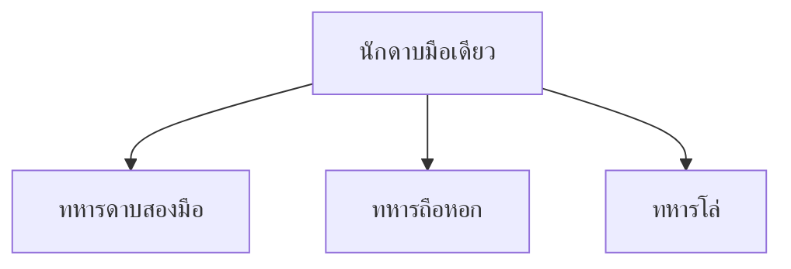

# ผังสายอาชีพนักรบ

แบบร่างสำหรับ Ayothaya Survival ตัวละครเริ่มเป็น **นักดาบมือเดียว** โดยใช้ตัวละครนักดาบฝึกหัดและชุดสกิลพื้นฐานจากเกมปัจจุบัน จากนั้นเลือกฝึกอาวุธเฉพาะทางหนึ่งในสามสาย

| สายอาชีพ | อาวุธ | ค่าสเตตัสหลักที่เสนอ | ตัวอย่างสกิลประจำสาย |
| --- | --- | --- | --- |
| **ทหารดาบสองมือ** | ดาบใหญ่หนึ่งเล่ม จับด้วยสองมือ | STR / VIT | **ฟันกวาดสองมือ** ง้างดาบแล้วฟันหนักเป็นวงกว้างด้านหน้า เหมาะกับศัตรูที่ยืนรวมกัน |
| **ทหารถือหอก** | หอก | DEX / STR | **แทงทะลวง** แทงตามแนวตรงจากระยะที่ไกลกว่าดาบ เหมาะกับการคุมช่องทางแคบ |
| **ทหารโล่** | ดาบมือเดียวกับโล่หวาย | VIT / STR | **โล่สวนกลับ** ยกโล่รับจังหวะโจมตีแล้วสวนด้วยดาบ เหมาะกับการยืนแนวหน้า |

## พื้นฐาน (Base) และเชี่ยวชาญ (Job)

| เลเวล | ใช้กับอะไร |
| --- | --- |
| **พื้นฐาน (Base)** | ความแข็งแกร่งของตัวละครโดยรวม ใช้กำหนด HP สูงสุด พลังโจมตีพื้นฐาน และเงื่อนไขเลเวลของตัวละคร |
| **เชี่ยวชาญ (Job)** | ความชำนาญด้านอาชีพ ใช้เป็นเงื่อนไขเปิดสกิลร่วมกับเลเวลพื้นฐานและค่าสเตตัส |

## เงื่อนไขเลื่อนอาชีพ

- เกณฑ์ที่เสนอคือ **พื้นฐาน Lv. 6** และ **เชี่ยวชาญ Lv. 5** หลังส่งเควสต์ **เฝ้าท่ามะขาม** ให้คุยกับยามประตูท่าเพื่อเลือกสาย
- ยามให้ยืมอาวุธและสกิลเฉพาะรอบทดสอบ ทหารดาบสองมือฝึกฟันหุ่นหลายตัวในวงกว้าง ทหารถือหอกฝึกแทงจากจุดที่กำหนด และทหารโล่ฝึกยกโล่ให้ทันจังหวะโจมตีของคู่ซ้อม
- เมื่อเปลี่ยนอาชีพ เลเวลทั้งสอง แต้มสถานะ อุปกรณ์ และสกิลที่เรียนจะติดไปด้วย สกิลที่ระบุอาวุธต้องสวมอาวุธให้ตรงจึงจะใช้ได้ รวมถึงเมื่อกดผ่านช่องลัด 1–5 หรือใช้ผ่าน Auto

## การอ่านผังในเกม

แต่ละช่องแสดงชื่ออาชีพ อาวุธ บทบาท ค่าสเตตัส และเงื่อนไขของสายนั้น หน้าต่าง Class Tree ใช้พรีวิวท่าถืออาวุธและสกิลประจำสายก่อนเลือกอาชีพ
